# Baclogged: Game Review & Collection Platform

Baclogged is a full-stack game review and collection platform where users can discover games, maintain their personal collections, rate and review games, and interact with community content.

The platform integrates the RAWG Video Games Database API with a MongoDB-backed caching layer to reduce redundant external API requests. It also includes role-based authentication, moderation workflows, AI-powered avatar moderation, secure payment processing, database-level constraints, rate limiting, and duplicate-prevention mechanisms.

## 🚀 Live Demo & Repository

- **Live Demo:** [baclogged.in](https://www.baclogged.in/)
- **GitHub Repository:** [github.com/himanshugour23-dev/Review-Project](https://github.com/himanshugour23-dev/Review-Project)

---

## ✨ Features

### 🎮 Game Discovery & Collection

- Browse and discover games using the RAWG Video Games Database API.
- View detailed game information including metadata, genres, ratings, release information, and artwork.
- Maintain personal game collections and track games based on their status.
- Game data is progressively persisted into the local database as users interact with the platform.

### ⚡ API Caching Layer

- Implemented a MongoDB-backed caching layer around the RAWG API.
- Previously fetched game data is served from the database instead of repeatedly requesting the external API.
- Reduces redundant third-party API calls and improves response time for repeated searches.
- Cached records include game metadata and freshness information to control when data should be refreshed.

### 🔐 Authentication & Role-Based Access Control

- Implemented authentication using NextAuth.js.
- Supports OAuth-based authentication.
- Added role-based access control for standard users and administrators.
- Administrators have dedicated moderation capabilities for managing community content.

### 💳 Secure Payment Integration

- Integrated the Razorpay payment gateway.
- Implemented HMAC-SHA256 signature verification for payment authenticity.
- Added server-side price validation to prevent client-side price manipulation.
- Implemented idempotent payment callback handling to prevent duplicate access grants.

### 🛡️ Review & Moderation System

- Users can create ratings and reviews for games.
- Enforced a one-review-per-user-per-game constraint at the database level.
- Added review reporting functionality.
- Implemented an administrative review queue for reported content.
- Added per-user daily rate limits for reporting actions.
- Prevented duplicate reports using a unique compound database index.
- Added moderation controls for administrators to maintain content quality.

### 🤖 AI-Powered Avatar Moderation

- Built a two-stage avatar moderation system to keep inappropriate images off the platform.
- **Stage 1 (pre-upload screening):** images are screened with the Gemini API before they are uploaded.
- **Stage 2 (asynchronous moderation):** uploaded images are moderated asynchronously using Cloudinary Rekognition.
- Webhook-triggered automatic deletion of flagged images, with no manual admin intervention required.

### 🗄️ Database-Level Integrity

- Used atomic database operations for critical review-related workflows.
- Enforced uniqueness constraints to prevent duplicate submissions.
- Database-level restrictions prevent rating inflation caused by multiple reviews from the same user.
- Compound indexes are used for efficient queries and duplicate prevention.

---

## 🛠️ Tech Stack

### Frontend

- React.js
- Next.js
- Next.js App Router
- Tailwind CSS
- Progressive Web App (PWA)

### Backend

- Node.js
- Next.js API Routes
- Next.js Server Actions
- REST APIs

### Authentication

- NextAuth.js
- OAuth
- Role-Based Access Control (RBAC)

### Database

- MongoDB
- Mongoose

### External Services

- RAWG Video Games Database API
- Razorpay Payment Gateway
- Gemini API (pre-upload avatar screening)
- Cloudinary (image hosting and Rekognition-based moderation)

### Developer Tools

- Git
- GitHub
- Postman
- Vercel

---

## 🏗️ Architecture & Database Design

Baclogged uses a MongoDB-based architecture with separate collections for users, games, reviews, reports, and user-specific game data.

### 🗺️ System Architecture Diagram

An implementation-driven interactive architecture page is available in the app at **`/architecture`**.
It supports pan/zoom, layer/domain filtering, and node-level file details based on the current codebase.

```mermaid
flowchart TD

subgraph group_discovery["Game discovery"]
  node_browse["Browse games<br/>[page.tsx]"]
  node_discover["Discover picks<br/>[DiscoverClient.tsx]"]
  node_gameview["Game details<br/>[page.tsx]"]
  node_gameapi["Game detail API<br/>[route.ts]"]
  node_gameendpoints["Game discovery APIs"]
end

subgraph group_community["Reviews and moderation"]
  node_reviewform["Review experience<br/>[page.tsx]"]
  node_reviewapi["Review API<br/>[route.ts]"]
  node_reviewdata[("Reviews<br/>[review.ts]")]
  node_reactionapi["Reaction API<br/>[route.ts]"]
  node_reactiondata[("Review reactions<br/>[reviewReaction.ts]")]
  node_reportapi["Report API<br/>[route.ts]"]
  node_reportdata[("Reports<br/>[report.ts]")]
  node_moderation["Admin moderation<br/>[page.tsx]"]
end

subgraph group_identity["Identity and profiles"]
  node_auth["Authentication<br/>[auth.ts]"]
  node_authroute["Auth endpoint<br/>[route.ts]"]
  node_profiles["Profile and collection<br/>[page.tsx]"]
  node_userapi["User APIs"]
  node_userdata[("Users<br/>[User.ts]")]
  node_avatar["Avatar moderation<br/>[avatarModration.ts]"]
  node_avatarapi["Avatar endpoint<br/>[route.ts]"]
  node_webhook["Moderation webhook<br/>[route.ts]"]
end

subgraph group_commerce["Premium and payments"]
  node_checkout["Checkout details<br/>[page.tsx]"]
  node_checkoutbutton["Razorpay checkout"]
  node_orderapi["Order API<br/>[route.ts]"]
  node_paymentapi["Payment callback<br/>[route.ts]"]
  node_paymentdata[("Payments<br/>[payment.ts]")]
end

subgraph group_platform["Data and integrations"]
  node_rawgclient["RAWG client<br/>[rawg.ts]"]
  node_gamecache[("Game cache<br/>[game.ts]")]
  node_dbconnection["Database connection<br/>[db.ts]"]
end

node_visitor(("Player"))
node_rawgservice["RAWG service"]
node_cloudinary["Cloudinary"]
node_razorpay["Razorpay"]
node_database[("MongoDB")]

node_visitor -->|"browses"| node_browse
node_visitor -->|"discovers"| node_discover
node_visitor -->|"opens game"| node_gameview
node_discover -.->|"loads picks"| node_gameendpoints
node_browse -.->|"requests games"| node_gameendpoints
node_gameview -.->|"loads details"| node_gameapi
node_gameapi -->|"reads game"| node_gamecache
node_gameapi -->|"loads reviews"| node_reviewdata
node_gameapi -->|"loads authors"| node_userdata
node_gameapi -->|"loads reactions"| node_reactiondata
node_gameapi -->|"fetches details"| node_rawgclient
node_rawgclient -.->|"requests metadata"| node_rawgservice
node_visitor -->|"writes review"| node_reviewform
node_reviewform -.->|"submits review"| node_reviewapi
node_reviewapi -->|"resolves author"| node_userdata
node_reviewapi -->|"checks game"| node_gamecache
node_reviewapi -->|"upserts review"| node_reviewdata
node_reviewapi -->|"updates rating"| node_gamecache
node_visitor -->|"reacts"| node_reactionapi
node_reactionapi -->|"writes reaction"| node_reactiondata
node_visitor -->|"reports review"| node_reportapi
node_reportapi -->|"checks review"| node_reviewdata
node_reportapi -->|"creates report"| node_reportdata
node_moderation -.->|"reviews queue"| node_reportdata
node_visitor -->|"signs in"| node_authroute
node_authroute -.->|"uses auth"| node_auth
node_auth -->|"loads identity"| node_userdata
node_profiles -.->|"loads profile"| node_userapi
node_userapi -->|"reads profile"| node_userdata
node_visitor -->|"updates avatar"| node_avatarapi
node_avatarapi -.->|"screens upload"| node_avatar
node_avatar -.->|"uploads image"| node_cloudinary
node_cloudinary -->|"sends event"| node_webhook
node_webhook -->|"deletes flagged image"| node_cloudinary
node_webhook -->|"clears avatar"| node_userdata
node_visitor -->|"starts purchase"| node_checkout
node_checkout -->|"renders checkout"| node_checkoutbutton
node_checkoutbutton -.->|"creates order"| node_orderapi
node_orderapi -.->|"creates payment"| node_razorpay
node_razorpay -.->|"returns payment"| node_paymentapi
node_paymentapi -->|"records payment"| node_paymentdata
node_paymentapi -->|"grants premium"| node_userdata
node_gameapi -->|"connects database"| node_dbconnection
node_reviewapi -->|"connects database"| node_dbconnection
node_reactionapi -->|"connects database"| node_dbconnection
node_reportapi -->|"connects database"| node_dbconnection
node_dbconnection -->|"connects"| node_database
node_visitor -->|"manages collection"| node_profiles

classDef toneNeutral fill:#f8fafc,stroke:#334155,stroke-width:1.5px,color:#0f172a
classDef toneBlue fill:#dbeafe,stroke:#2563eb,stroke-width:1.5px,color:#172554
classDef toneAmber fill:#fef3c7,stroke:#d97706,stroke-width:1.5px,color:#78350f
classDef toneMint fill:#dcfce7,stroke:#16a34a,stroke-width:1.5px,color:#14532d
classDef toneRose fill:#ffe4e6,stroke:#e11d48,stroke-width:1.5px,color:#881337
classDef toneIndigo fill:#e0e7ff,stroke:#4f46e5,stroke-width:1.5px,color:#312e81
classDef toneTeal fill:#ccfbf1,stroke:#0f766e,stroke-width:1.5px,color:#134e4a
class node_browse,node_discover,node_gameview,node_gameapi,node_gameendpoints toneBlue
class node_reviewform,node_reviewapi,node_reviewdata,node_reactionapi,node_reactiondata,node_reportapi,node_reportdata,node_moderation,node_database toneAmber
class node_auth,node_authroute,node_profiles,node_userapi,node_userdata,node_avatar,node_avatarapi,node_webhook toneMint
class node_checkout,node_checkoutbutton,node_orderapi,node_paymentapi,node_paymentdata toneRose
class node_rawgclient,node_gamecache,node_dbconnection,node_visitor,node_rawgservice,node_cloudinary,node_razorpay toneIndigo
```



### 👤 Users & Profiles

Stores user identity, authentication provider information, profile details, roles, and user-specific game preferences.

### 🎮 Game Cache

Stores game information retrieved from the RAWG API.

The cached data contains information such as:

- RAWG Game ID
- Game name
- Slug
- Cover image
- Genres
- Release date
- Average rating
- Review count
- Last fetched timestamp

This allows frequently requested games to be served from MongoDB instead of repeatedly querying the RAWG API.

### ⭐ Reviews & Ratings

Reviews are associated with both users and games.

A unique database constraint ensures:

```text
One user → One review → One game
```

### 🚩 Reports & Moderation Queue

Reports are linked to reviews and the reporting user. A unique compound index prevents duplicate reports, and per-user daily rate limits prevent report spam. Reported content is surfaced to administrators through a dedicated review queue.

### 🖼️ Avatar Moderation Pipeline

```text
User selects avatar
        ↓
Stage 1: Gemini API screening (pre-upload)
        ↓ (passes)
Upload to Cloudinary
        ↓
Stage 2: Cloudinary Rekognition (asynchronous moderation)
        ↓ (flagged)
Webhook triggers automatic deletion of the image
```
