# Baclogged: Game Review & Collection Platform

Baclogged is a full-stack game review and collection platform where users can discover games, maintain personal collections, rate and review titles, and interact with community content.

The platform uses the IGDB API as its game data source, backed by MongoDB persistence and caching. It also includes OAuth authentication, role-based access control, review moderation, AI-assisted avatar moderation, secure payment processing, and database-level integrity constraints.

## 🚀 Live Demo & Repository

- **Live Demo:** [baclogged.in](https://www.baclogged.in/)
- **GitHub Repository:** [github.com/himanshugour23-dev/Review-Project](https://github.com/himanshugour23-dev/Review-Project)

---

## ✨ Features

### 🎮 Game Discovery & Collection

- Browse and discover games using the IGDB API.
- View detailed game information, including summaries, storylines, genres, platforms, themes, game modes, player perspectives, keywords, franchises, release information, ratings, screenshots, videos, and similar games.
- Explore developer and publisher information, plus game artworks through the Premium tier.
- Maintain personal game collections and track games based on their status.
- Persist game records in MongoDB so frequently requested information can be served locally.

### 🔄 RAWG-to-IGDB Data Migration

- Migrated the platform's game data source from RAWG to IGDB.
- Introduced a dedicated IGDB game model and collection (`igdb_games`) with IGDB-specific identifiers and metadata.
- Updated game data handling to use IGDB IDs, slugs, cover image references, ratings, platforms, genres, and expanded metadata.
- Migrated existing review references from the legacy RAWG game records to their corresponding IGDB game records.
- Used slug-based mapping between legacy and replacement game records to resolve the new game references.
- Kept review documents and their user-generated content intact while updating their associated game IDs.
- Created a backup of review-to-game references before applying the migration, allowing the previous references to be recovered if needed.

### ⚡ IGDB Integration & Database Caching

- Integrated the IGDB API as the primary source for game metadata.
- Implemented the IGDB authentication flow using Twitch credentials and OAuth access tokens.
- Store game information in MongoDB to reduce repeated external API requests.
- Serve previously fetched game records from the database and refresh records according to their freshness timestamp.
- Store expanded IGDB metadata, including ratings, screenshots, artworks, videos, platforms, genres, themes, game modes, player perspectives, keywords, franchises, and related games.

### 🔐 Authentication & Role-Based Access Control

- Implemented authentication using NextAuth.js.
- Supports OAuth-based authentication.
- Added role-based access control for standard users and administrators.
- Administrators have dedicated moderation capabilities for managing community content.

### 💳 Secure Payment Integration

- Integrated the Razorpay payment gateway.
- Implemented HMAC-SHA256 signature verification for payment authenticity.
- Added server-side price validation to prevent client-side price manipulation.
- Implemented idempotent payment callback handling to prevent duplicate access grants.

### ⭐ Premium Features

- Premium access unlocks additional game information, including developers, publishers, and artworks.
- Core discovery and game information remain available without Premium, including screenshots, videos, websites and store links, DLC, similar games, ratings, genres, platforms, themes, game modes, keywords, franchises, summaries, and storylines.

### 🛡️ Review & Moderation System

- Users can create ratings and reviews for games.
- Enforced a one-review-per-user-per-game constraint at the database level.
- Added review reporting functionality.
- Implemented an administrative review queue for reported content.
- Added per-user daily rate limits for reporting actions.
- Prevented duplicate reports using a unique compound database index.
- Added moderation controls for administrators to maintain content quality.

### 🤖 AI-Powered Avatar Moderation

- Built a two-stage avatar moderation system to keep inappropriate images off the platform.
- **Stage 1 (pre-upload screening):** images are screened with the Gemini API before they are uploaded.
- **Stage 2 (asynchronous moderation):** uploaded images are moderated asynchronously using Cloudinary Rekognition.
- Webhook-triggered automatic deletion of flagged images, with no manual admin intervention required.

### 🗄️ Database-Level Integrity

- Used atomic database operations for critical review-related workflows.
- Enforced uniqueness constraints to prevent duplicate submissions.
- Database-level restrictions prevent rating inflation caused by multiple reviews from the same user.
- Compound indexes are used for efficient queries and duplicate prevention.

---

## 🛠️ Tech Stack

### Frontend

- React.js
- Next.js
- Next.js App Router
- Tailwind CSS
- Progressive Web App (PWA)

### Backend

- Node.js
- Next.js API Routes
- Next.js Server Actions
- REST APIs

### Authentication

- NextAuth.js
- OAuth
- Twitch OAuth 2.0 (IGDB API authentication)
- Role-Based Access Control (RBAC)

### Database

- MongoDB
- Mongoose

### External Services

- IGDB API (game metadata and discovery)
- Twitch OAuth 2.0 (IGDB access tokens)
- Razorpay Payment Gateway
- Gemini API (pre-upload avatar screening)
- Cloudinary (image hosting and Rekognition-based moderation)

### Developer Tools

- Git
- GitHub
- Postman
- Vercel

---

## 🏗️ Architecture & Database Design

Baclogged uses a MongoDB-based architecture with separate collections for users, IGDB games, reviews, reports, payments, and user-specific game data.

### 🗺️ System Architecture Diagram

```mermaid
flowchart TD

subgraph group_discovery["Game discovery"]
  node_browse["Browse games<br/>[page.tsx]"]
  node_discover["Discover picks<br/>[DiscoverClient.tsx]"]
  node_gameview["Game details<br/>[page.tsx]"]
  node_gameapi["Game detail API<br/>[route.ts]"]
  node_gameendpoints["Game discovery APIs"]
end

subgraph group_community["Reviews and moderation"]
  node_reviewform["Review experience<br/>[page.tsx]"]
  node_reviewapi["Review API<br/>[route.ts]"]
  node_reviewdata[("Reviews<br/>[review.ts]")]
  node_reactionapi["Reaction API<br/>[route.ts]"]
  node_reactiondata[("Review reactions<br/>[reviewReaction.ts]")]
  node_reportapi["Report API<br/>[route.ts]"]
  node_reportdata[("Reports<br/>[report.ts]")]
  node_moderation["Admin moderation<br/>[page.tsx]"]
end

subgraph group_identity["Identity and profiles"]
  node_auth["Authentication<br/>[auth.ts]"]
  node_authroute["Auth endpoint<br/>[route.ts]"]
  node_profiles["Profile and collection<br/>[page.tsx]"]
  node_userapi["User APIs"]
  node_userdata[("Users<br/>[User.ts]")]
  node_avatar["Avatar moderation<br/>[avatarModration.ts]"]
  node_avatarapi["Avatar endpoint<br/>[route.ts]"]
  node_webhook["Moderation webhook<br/>[route.ts]"]
end

subgraph group_commerce["Premium and payments"]
  node_checkout["Checkout details<br/>[page.tsx]"]
  node_checkoutbutton["Razorpay checkout"]
  node_orderapi["Order API<br/>[route.ts]"]
  node_paymentapi["Payment callback<br/>[route.ts]"]
  node_paymentdata[("Payments<br/>[payment.ts]")]
end

subgraph group_platform["Game data and integrations"]
  node_igdbclient["IGDB client<br/>[igdb.ts]"]
  node_igdbcache[("IGDB game records<br/>[igdbGames.ts]")]
  node_twitchauth["Twitch OAuth 2.0"]
  node_dbconnection["Database connection<br/>[db.ts]"]
end

node_visitor(("Player"))
node_igdbservice["IGDB API"]
node_cloudinary["Cloudinary"]
node_razorpay["Razorpay"]
node_database[("MongoDB")]

node_visitor -->|"browses"| node_browse
node_visitor -->|"discovers"| node_discover
node_visitor -->|"opens game"| node_gameview
node_discover -.->|"loads picks"| node_gameendpoints
node_browse -.->|"requests games"| node_gameendpoints
node_gameview -.->|"loads details"| node_gameapi
node_gameapi -->|"reads game"| node_igdbcache
node_gameapi -->|"loads reviews"| node_reviewdata
node_gameapi -->|"loads authors"| node_userdata
node_gameapi -->|"loads reactions"| node_reactiondata
node_gameapi -->|"requests game data"| node_igdbclient
node_igdbclient -.->|"gets access token"| node_twitchauth
node_twitchauth -.->|"authenticates"| node_igdbservice
node_igdbclient -.->|"requests metadata"| node_igdbservice
node_visitor -->|"writes review"| node_reviewform
node_reviewform -.->|"submits review"| node_reviewapi
node_reviewapi -->|"resolves author"| node_userdata
node_reviewapi -->|"checks game"| node_igdbcache
node_reviewapi -->|"upserts review"| node_reviewdata
node_reviewapi -->|"updates rating"| node_igdbcache
node_visitor -->|"reacts"| node_reactionapi
node_reactionapi -->|"writes reaction"| node_reactiondata
node_visitor -->|"reports review"| node_reportapi
node_reportapi -->|"checks review"| node_reviewdata
node_reportapi -->|"creates report"| node_reportdata
node_moderation -.->|"reviews queue"| node_reportdata
node_visitor -->|"signs in"| node_authroute
node_authroute -.->|"uses auth"| node_auth
node_auth -->|"loads identity"| node_userdata
node_profiles -.->|"loads profile"| node_userapi
node_userapi -->|"reads profile"| node_userdata
node_visitor -->|"updates avatar"| node_avatarapi
node_avatarapi -.->|"screens upload"| node_avatar
node_avatar -.->|"uploads image"| node_cloudinary
node_cloudinary -->|"sends event"| node_webhook
node_webhook -->|"deletes flagged image"| node_cloudinary
node_webhook -->|"clears avatar"| node_userdata
node_visitor -->|"starts purchase"| node_checkout
node_checkout -->|"renders checkout"| node_checkoutbutton
node_checkoutbutton -.->|"creates order"| node_orderapi
node_orderapi -.->|"creates payment"| node_razorpay
node_razorpay -.->|"returns payment"| node_paymentapi
node_paymentapi -->|"records payment"| node_paymentdata
node_paymentapi -->|"grants premium"| node_userdata
node_gameapi -->|"connects database"| node_dbconnection
node_reviewapi -->|"connects database"| node_dbconnection
node_reactionapi -->|"connects database"| node_dbconnection
node_reportapi -->|"connects database"| node_dbconnection
node_dbconnection -->|"connects"| node_database
node_visitor -->|"manages collection"| node_profiles

classDef toneNeutral fill:#f8fafc,stroke:#334155,stroke-width:1.5px,color:#0f172a
classDef toneBlue fill:#dbeafe,stroke:#2563eb,stroke-width:1.5px,color:#172554
classDef toneAmber fill:#fef3c7,stroke:#d97706,stroke-width:1.5px,color:#78350f
classDef toneMint fill:#dcfce7,stroke:#16a34a,stroke-width:1.5px,color:#14532d
classDef toneRose fill:#ffe4e6,stroke:#e11d48,stroke-width:1.5px,color:#881337
classDef toneIndigo fill:#e0e7ff,stroke:#4f46e5,stroke-width:1.5px,color:#312e81
class node_browse,node_discover,node_gameview,node_gameapi,node_gameendpoints toneBlue
class node_reviewform,node_reviewapi,node_reviewdata,node_reactionapi,node_reactiondata,node_reportapi,node_reportdata,node_moderation,node_database toneAmber
class node_auth,node_authroute,node_profiles,node_userapi,node_userdata,node_avatar,node_avatarapi,node_webhook toneMint
class node_checkout,node_checkoutbutton,node_orderapi,node_paymentapi,node_paymentdata toneRose
class node_igdbclient,node_igdbcache,node_twitchauth,node_visitor,node_igdbservice,node_cloudinary,node_razorpay toneIndigo
```



### 👤 Users & Profiles

Stores user identity, authentication provider information, profile details, roles, and user-specific game preferences.

### 🎮 IGDB Game Records

Stores game information retrieved from IGDB in the dedicated `igdb_games` collection.

The stored game data includes:

- IGDB game ID
- Game name and slug
- Cover image
- Summary and storyline
- Genres, platforms, themes, game modes, and player perspectives
- Keywords and franchises
- Release date and category
- IGDB rating and rating counts
- Aggregated rating and rating counts
- Screenshots, artworks, and videos
- Similar games and related game information
- Last-fetched timestamp

This allows frequently requested game information to be served from MongoDB instead of repeatedly querying IGDB.

### 🔄 Game and Review Migration

The migration moved the application from the legacy RAWG game collection to the new IGDB game collection.

At a high level, the migration process:

1. Reads existing game and review references from the legacy data.
2. Builds a mapping between legacy RAWG game slugs and their corresponding IGDB game records.
3. Resolves the destination IGDB game document for each existing review.
4. Updates the review's `gameId` reference to the new IGDB document ID.
5. Keeps the existing review documents and user-generated review content rather than recreating reviews.
6. Uses a backup of the original review-to-game references as a recovery point.

The dedicated IGDB model and collection keep the new game schema separate from the legacy RAWG schema.

### ⭐ Reviews & Ratings

Reviews are associated with both users and IGDB game records.

A unique database constraint ensures:

```text
One user → One review → One game
```

### 🚩 Reports & Moderation Queue

Reports are linked to reviews and the reporting user. A unique compound index prevents duplicate reports, and per-user daily rate limits prevent report spam. Reported content is surfaced to administrators through a dedicated review queue.

### 🖼️ Avatar Moderation Pipeline

```text
User selects avatar
        ↓
Stage 1: Gemini API screening (pre-upload)
        ↓ (passes)
Upload to Cloudinary
        ↓
Stage 2: Cloudinary Rekognition (asynchronous moderation)
        ↓ (flagged)
Webhook triggers automatic deletion of the image
```
