# Baclogged: Game Review & Collection Platform

Baclogged is a full-stack game review and collection platform where users can discover games, maintain personal collections, rate and review titles, and interact with community content.

The platform focuses on game discovery, user-generated content, data integrity, secure payment processing, and content moderation.

**Live Demo:** https://baclogged.in  
**GitHub Repository:** https://github.com/himanshugour23-dev/Review-Project

---

## ✨ Features

### 🎮 Game Discovery & Collection

- Browse and discover games.
- Search for games and explore detailed game information.
- View game summaries, storylines, genres, platforms, themes, game modes, player perspectives, keywords, franchises, release information, ratings, screenshots, videos, and similar games.
- Explore developer and publisher information and game artworks through the Premium tier.
- Maintain personal game collections and track games based on their status.
- Persist game records in MongoDB.

### 🔄 RAWG-to-IGDB Migration

- Migrated the platform's game data source from RAWG to IGDB.
- Introduced a dedicated IGDB game model and collection (`igdb_games`).
- Updated game data handling to use IGDB identifiers, slugs, cover image references, ratings, platforms, genres, and additional metadata.
- Migrated existing review references from legacy RAWG game records to their corresponding IGDB game records.
- Used slug-based mapping between legacy and replacement game records.
- Preserved existing review documents and user-generated content while updating their associated game IDs.
- Created a backup of original review-to-game references before migration.

### ⚡ API Integration & MongoDB Caching

**Original RAWG caching implementation:**

- Designed and implemented a MongoDB-backed caching layer around the RAWG API.
- Checked MongoDB for existing game data before making external API requests.
- Fetched data from RAWG when the required information was not already available locally.
- Persisted fetched game information in MongoDB to reduce redundant external requests.
- Used the growing local game database to support richer Browse and Discover experiences.
- Reported a 50% reduction in redundant API calls and approximately 200 ms improvement in repeat-search latency.

**IGDB integration:**

- Replaced RAWG with IGDB as the primary game data provider.
- Integrated Twitch OAuth 2.0 authentication for IGDB API access.
- Introduced a dedicated IGDB schema with support for expanded game metadata.
- Persisted IGDB game records in MongoDB.

### 🔐 Authentication & Role-Based Access Control

- Implemented authentication using NextAuth.js.
- Supports Google and GitHub OAuth.
- Implemented role-based access control for standard users and administrators.
- Added administrative capabilities for managing community content.

### 💳 Secure Payment Integration

- Integrated the Razorpay payment gateway.
- Implemented HMAC-SHA256 signature verification.
- Added server-side price validation to prevent client-side price manipulation.
- Implemented idempotent payment callback handling to prevent duplicate access grants.

### ⭐ Premium Features

Premium access unlocks additional game information, including:

- Developer information.
- Publisher information.
- Game artworks.

Core game discovery and information remain available without Premium, including screenshots, videos, websites and store links, DLC, similar games, ratings, genres, platforms, themes, game modes, keywords, franchises, summaries, and storylines.

### 🛡️ Review & Moderation System

- Users can create ratings and reviews for games.
- Enforced a one-review-per-user-per-game constraint at the database level.
- Implemented atomic database operations for review-related workflows.
- Prevented duplicate review submissions and rating inflation.
- Added review reporting functionality.
- Implemented per-user daily rate limits for reporting actions.
- Prevented duplicate reports using a unique compound database index.
- Built an administrative review queue for reviewing reported content.

### 🤖 AI-Powered Avatar Moderation

Implemented a two-stage avatar moderation pipeline.

**Stage 1 – Pre-upload screening**
- Uses the Gemini API to screen images before upload.

**Stage 2 – Asynchronous moderation**
- Uses Cloudinary Rekognition to moderate uploaded images asynchronously.
- Uses webhook-triggered automatic deletion of flagged images.

### 📱 Progressive Web App

- Installable as a Progressive Web App (PWA).
- Background sync and deeper offline support are planned improvements.

---

## 🛠️ Tech Stack

### Frontend
- React.js
- Next.js
- Next.js App Router
- Tailwind CSS
- Progressive Web App (PWA)

### Backend
- Node.js
- Next.js API Routes
- Next.js Server Actions
- REST APIs

### Authentication
- NextAuth.js
- Google OAuth
- GitHub OAuth
- Twitch OAuth 2.0 for IGDB API authentication
- Role-Based Access Control (RBAC)

### Database
- MongoDB
- Mongoose

### External Services
- IGDB API
- Twitch OAuth 2.0
- Razorpay Payment Gateway
- Gemini API
- Cloudinary Rekognition

### Developer Tools
- Git
- GitHub
- Postman
- Vercel

---

## 🏗️ Architecture & Database Design

Baclogged uses MongoDB to persist user information, game records, reviews, reports, payments, and user-specific game data.

### Main Application Components

- **Game Discovery:** Browse, Discover, Search, Home, and Game Details.
- **Community:** Reviews, ratings, reactions, reporting, and moderation.
- **Identity:** Authentication, user profiles, and personal collections.
- **Payments:** Checkout, Razorpay order creation, payment verification, and Premium access.
- **Game Data:** IGDB API integration and persistent game records.

### Application Architecture Diagram

The diagram below maps the main user-facing experiences to their API routes, external services, and MongoDB models. The nodes include links to the corresponding source files in the repository.

```mermaid
flowchart TD

subgraph group_experience["User experience"]
  node_home["Home experience<br/>[HomePage.tsx]"]
  node_features["Feature overview"]
  node_navbar["Navigation<br/>[Navbar.tsx]"]
  node_network["Network warning"]
  node_maintenance["Maintenance screen<br/>[DinoRunner.tsx]"]
  node_game_loading["Game loading UI<br/>[SleepLoader.tsx]"]
end

subgraph group_games["Game discovery"]
  node_browse_ui["Browse games<br/>[page.tsx]"]
  node_discover_ui["Discover games<br/>[DiscoverClient.tsx]"]
  node_game_page["Game details<br/>[page.tsx]"]
  node_creator_page["Creator details<br/>[page.tsx]"]
  node_game_routes["Game API<br/>[route.ts]"]
  node_game_lists["Browse and search APIs<br/>[route.ts]"]
  node_igdb_client["IGDB integration<br/>[igdb.ts]"]
  node_game_model[("IGDB game records<br/>[igdbGames.ts]")]
end

subgraph group_community["Community and moderation"]
  node_reviews_api["Review API<br/>[route.ts]"]
  node_review_model[("Reviews<br/>[review.ts]")]
  node_reaction_api["Reaction API<br/>[route.ts]"]
  node_reaction_model[("Review reactions<br/>[reviewReaction.ts]")]
  node_report_api["Report submission<br/>[route.ts]"]
  node_report_model[("Reports<br/>[report.ts]")]
  node_admin_queue["Moderation queue<br/>[page.tsx]"]
  node_admin_api["Admin report API<br/>[route.ts]"]
end

subgraph group_identity["Identity and profiles"]
  node_auth["Authentication<br/>[auth.ts]"]
  node_user_model[("User profiles<br/>[User.ts]")]
  node_profile_page["Personal collection<br/>[page.tsx]"]
  node_avatar_api["Avatar upload<br/>[route.ts]"]
  node_webhook["Avatar moderation webhook<br/>[route.ts]"]
end

subgraph group_commerce["Premium and payments"]
  node_checkout_page["Checkout details<br/>[page.tsx]"]
  node_checkout_button["Razorpay checkout"]
  node_order_api["Order creation<br/>[route.ts]"]
  node_callback_api["Payment callback<br/>[route.ts]"]
  node_payment_model[("Payments<br/>[payment.ts]")]
end

node_user(("Player"))
node_cloudinary{{"Cloudinary"}}

node_user -->|"opens"| node_home
node_home -->|"renders"| node_features
node_user -->|"browses"| node_browse_ui
node_user -->|"discovers"| node_discover_ui
node_discover_ui -->|"renders"| node_navbar
node_browse_ui -.->|"requests listings"| node_game_lists
node_discover_ui -->|"requests discovery"| node_game_lists
node_user -->|"opens title"| node_game_page
node_game_page -->|"renders"| node_game_loading
node_game_page -.->|"requests details"| node_game_routes
node_game_routes -->|"reads and updates"| node_game_model
node_game_routes -->|"fetches metadata"| node_igdb_client
node_user -->|"explores creators"| node_creator_page
node_user -->|"submits review"| node_reviews_api
node_reviews_api -->|"creates or updates"| node_review_model
node_reviews_api -->|"updates rating stats"| node_game_model
node_user -->|"reacts"| node_reaction_api
node_reaction_api -->|"creates or updates"| node_reaction_model
node_user -->|"reports review"| node_report_api
node_report_api -->|"creates report"| node_report_model
node_report_api -->|"checks existence"| node_review_model
node_admin_queue -.->|"manages reports"| node_admin_api
node_admin_api -.->|"reviews reports"| node_report_model
node_user -->|"signs in"| node_auth
node_auth -->|"loads identity"| node_user_model
node_user -->|"manages collection"| node_profile_page
node_user -->|"uploads avatar"| node_avatar_api
node_avatar_api -.->|"uploads image"| node_cloudinary
node_cloudinary -->|"sends moderation event"| node_webhook
node_webhook -->|"deletes flagged image"| node_cloudinary
node_webhook -->|"clears avatar"| node_user_model
node_user -->|"starts subscription"| node_checkout_page
node_checkout_page -->|"renders"| node_checkout_button
node_checkout_button -.->|"requests order"| node_order_api
node_callback_api -->|"records payment"| node_payment_model
node_callback_api -->|"grants premium"| node_user_model

click node_home "https://github.com/himanshugour23-dev/review-project/blob/main/homeComponents/HomePage.tsx"
click node_features "https://github.com/himanshugour23-dev/review-project/blob/main/homeComponents/FeatureOverview.tsx"
click node_navbar "https://github.com/himanshugour23-dev/review-project/blob/main/components/Navbar.tsx"
click node_network "https://github.com/himanshugour23-dev/review-project/blob/main/components/NetworkWarningPopup.tsx"
click node_maintenance "https://github.com/himanshugour23-dev/review-project/blob/main/components/DinoRunner.tsx"
click node_game_loading "https://github.com/himanshugour23-dev/review-project/blob/main/components/SleepLoader.tsx"
click node_browse_ui "https://github.com/himanshugour23-dev/review-project/blob/main/app/browse/page.tsx"
click node_discover_ui "https://github.com/himanshugour23-dev/review-project/blob/main/app/discover/DiscoverClient.tsx"
click node_game_page "https://github.com/himanshugour23-dev/review-project/blob/main/app/game/%5Bslug%5D/page.tsx"
click node_creator_page "https://github.com/himanshugour23-dev/review-project/blob/main/app/game/%5Bslug%5D/creators/page.tsx"
click node_game_routes "https://github.com/himanshugour23-dev/review-project/blob/main/app/api/games/%5Bslug%5D/route.ts"
click node_game_lists "https://github.com/himanshugour23-dev/review-project/blob/main/app/api/games/browse/route.ts"
click node_igdb_client "https://github.com/himanshugour23-dev/review-project/blob/main/lib/igdb.ts"
click node_game_model "https://github.com/himanshugour23-dev/review-project/blob/main/models/igdbGames.ts"
click node_reviews_api "https://github.com/himanshugour23-dev/review-project/blob/main/app/api/reviews/route.ts"
click node_review_model "https://github.com/himanshugour23-dev/review-project/blob/main/models/review.ts"
click node_reaction_api "https://github.com/himanshugour23-dev/review-project/blob/main/app/api/reactions/route.ts"
click node_reaction_model "https://github.com/himanshugour23-dev/review-project/blob/main/models/reviewReaction.ts"
click node_report_api "https://github.com/himanshugour23-dev/review-project/blob/main/app/api/reports/route.ts"
click node_report_model "https://github.com/himanshugour23-dev/review-project/blob/main/models/report.ts"
click node_admin_queue "https://github.com/himanshugour23-dev/review-project/blob/main/app/admin/reports/page.tsx"
click node_admin_api "https://github.com/himanshugour23-dev/review-project/blob/main/app/api/admin/reports/route.ts"
click node_auth "https://github.com/himanshugour23-dev/review-project/blob/main/lib/auth.ts"
click node_user_model "https://github.com/himanshugour23-dev/review-project/blob/main/models/User.ts"
click node_profile_page "https://github.com/himanshugour23-dev/review-project/blob/main/app/user/me/page.tsx"
click node_avatar_api "https://github.com/himanshugour23-dev/review-project/blob/main/app/api/user/me/avatar/route.ts"
click node_webhook "https://github.com/himanshugour23-dev/review-project/blob/main/app/api/cloudinary-webhook/route.ts"
click node_checkout_page "https://github.com/himanshugour23-dev/review-project/blob/main/app/checkoutPageDetails/page.tsx"
click node_checkout_button "https://github.com/himanshugour23-dev/review-project/blob/main/components/RazorpayCheckoutButton.tsx"
click node_order_api "https://github.com/himanshugour23-dev/review-project/blob/main/app/api/payment/create-order/route.ts"
click node_callback_api "https://github.com/himanshugour23-dev/review-project/blob/main/app/api/payment/callback/route.ts"
click node_payment_model "https://github.com/himanshugour23-dev/review-project/blob/main/models/payment.ts"

classDef toneNeutral fill:#f8fafc,stroke:#334155,stroke-width:1.5px,color:#0f172a
classDef toneBlue fill:#dbeafe,stroke:#2563eb,stroke-width:1.5px,color:#172554
classDef toneAmber fill:#fef3c7,stroke:#d97706,stroke-width:1.5px,color:#78350f
classDef toneMint fill:#dcfce7,stroke:#16a34a,stroke-width:1.5px,color:#14532d
classDef toneRose fill:#ffe4e6,stroke:#e11d48,stroke-width:1.5px,color:#881337
classDef toneIndigo fill:#e0e7ff,stroke:#4f46e5,stroke-width:1.5px,color:#312e81
classDef toneTeal fill:#ccfbf1,stroke:#0f766e,stroke-width:1.5px,color:#134e4a
class node_home,node_features,node_navbar,node_network,node_maintenance,node_game_loading toneBlue
class node_browse_ui,node_discover_ui,node_game_page,node_creator_page,node_game_routes,node_game_lists,node_igdb_client,node_game_model toneAmber
class node_reviews_api,node_review_model,node_reaction_api,node_reaction_model,node_report_api,node_report_model,node_admin_queue,node_admin_api toneMint
class node_auth,node_user_model,node_profile_page,node_avatar_api,node_webhook toneRose
class node_checkout_page,node_checkout_button,node_order_api,node_callback_api,node_payment_model,node_user,node_cloudinary toneIndigo
```

### Database Collections

The application uses dedicated models for its main entities:

- Users
- IGDB Games (`igdb_games`)
- Reviews
- Review Reactions
- Reports
- Payments

### Game Data Model

The IGDB game model supports:

- IGDB game ID
- Game name and slug
- Cover image
- Summary and storyline
- Genres and platforms
- Themes and game modes
- Player perspectives
- Keywords and franchises
- Release date and category
- IGDB ratings and rating counts
- Aggregated ratings and rating counts
- Screenshots, artworks, and videos
- Similar games and related game information
- Last-fetched timestamp

### Review Data Migration

The migration from RAWG to IGDB involved:

1. Reading existing game and review references.
2. Mapping legacy RAWG game slugs to corresponding IGDB game records.
3. Resolving the destination IGDB game document for each review.
4. Updating review `gameId` references to the new IGDB document IDs.
5. Preserving existing review documents and user-generated content.
6. Creating a backup of original review-to-game references.

### Database Integrity

- One review per user per game.
- Unique compound index for duplicate report prevention.
- Atomic database operations for critical review workflows.
- Database-level constraints to protect rating consistency.

---

## 🔒 Security & Reliability

- OAuth-based authentication.
- Role-based authorization.
- Server-side payment validation.
- HMAC-SHA256 payment signature verification.
- Idempotent payment callback handling.
- Database-level uniqueness constraints.
- Rate-limited review reporting.
- Automated avatar moderation and flagged-image deletion.

---

## 🚀 Project Highlights

- Built a full-stack game review and collection platform used by 50+ users.
- Implemented MongoDB-backed caching for the RAWG API, reporting 50% fewer redundant API calls and approximately 200 ms lower repeat-search latency.
- Migrated the game data infrastructure from RAWG to IGDB while preserving existing user reviews.
- Integrated secure Razorpay payment processing.
- Developed database-level integrity mechanisms for reviews and ratings.
- Built a two-stage AI-powered avatar moderation pipeline.
- Developed an administrative reporting and moderation workflow.

---

## 👨‍💻 Author

**Himanshu Gour**

GitHub: https://github.com/himanshugour23-dev

**Live Project:** https://baclogged.in
